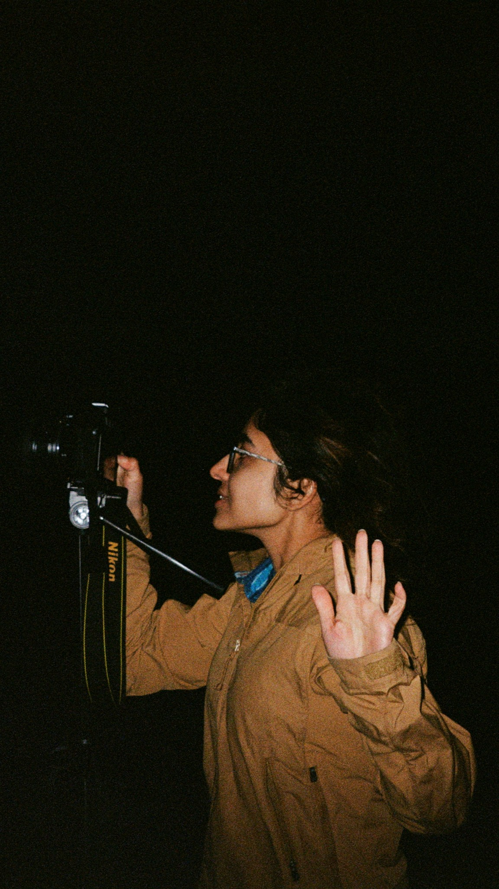

+++

title = "About"

+++

hi, i am suchitra. 

among many things, i am an amateur astronomer and i believe everyone must experience the wonder of looking at a sky with stars. i actively host and participate in star parties wherever i live as a way to build community. 

presently, i work in the biopharmaceutical industry building software that allow scientists to capture and reuse data. 
previously, i was that said scientist. i loved biochemistry but got frustrated with systems that made it easier to repeat an entire experiment than searching and finding data that already existed.

you'll find here a smattering of pieces of my life. i tweak, i read, i photograph and i play. and now, i write a little about it on a piece of the web i'd like to call mine. my principle is to keep this site simple, without any bloat, ads or login screens. i don't wish to promote this website - i made it so that i can share it with anyone who has a device that can access the internet.

if you stumbled upon here, welcome and happy browsing

